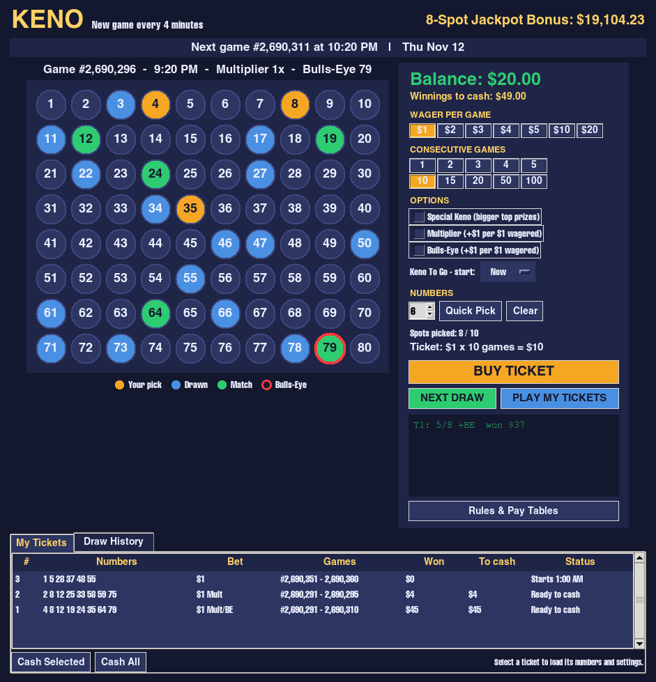

# Keno

A lottery-style Keno game in a single Python file, with a graphical board
(tkinter) and a text mode.



## Run

```sh
python3 keno.py          # graphical version
python3 keno.py --text   # terminal version
```

Needs Python 3 with tkinter (included with most Python installs; on Fedora
install `python3-tkinter`, on Debian/Ubuntu `python3-tk`). No other packages.

## How to play

- Click 1 to 10 numbers on the board, or use **Quick Pick**.
- Choose a wager ($1-$20 per game) and how many consecutive games to play
  (1-100, up to $100 per ticket).
- Optional add-ons:
  - **Special Keno**: bigger top prizes, fewer small prizes. No extra cost.
  - **Multiplier**: +$1 per $1. Multiplies Keno prizes by 1x-10x.
  - **Bulls-Eye**: +$1 per $1. Bonus prize if you picked the Bulls-Eye number.
  - **Keno To Go**: start your games at a later hour today.
- **BUY TICKET**, then **NEXT DRAW** (one animated game) or **PLAY MY TICKETS**
  (runs every game on your tickets).
- Cash winnings from the **My Tickets** tab. Past games are in **Draw History**.
- **Rules & Pay Tables** shows the full rules and prize tables.

A new game is drawn every 4 simulated minutes. Each game has its own game
number. Match 8 of 8 on an 8-spot ticket to win the rolling Jackpot Bonus.

## Odds

Odds of winning on one game. Each game draws 20 of the 80 numbers.

| Spots | Any Keno prize | Any Special Keno prize | Any Bulls-Eye prize | Top prize (all spots) | Keno return |
|---:|---:|---:|---:|---:|---:|
| 10 | 1 in 9.05 | 1 in 75.57 | 1 in 8.00 | 1 in 8,911,711 | 65.3% |
| 9 | 1 in 6.53 | 1 in 25.68 | 1 in 8.89 | 1 in 1,380,688 | 64.9% |
| 8 | 1 in 9.77 | 1 in 48.00 | 1 in 10.00 | 1 in 230,115 | 64.9% |
| 7 | 1 in 4.23 | 1 in 16.24 | 1 in 11.43 | 1 in 40,979 | 65.3% |
| 6 | 1 in 6.19 | 1 in 31.48 | 1 in 13.33 | 1 in 7,753 | 64.9% |
| 5 | 1 in 10.34 | 1 in 78.51 | 1 in 16.00 | 1 in 1,551 | 64.9% |
| 4 | 1 in 3.86 | 1 in 21.59 | 1 in 20.00 | 1 in 326 | 64.9% |
| 3 | 1 in 6.55 | 1 in 72.07 | 1 in 26.67 | 1 in 72 | 65.2% |
| 2 | 1 in 16.63 | 1 in 16.63 | 1 in 40.00 | 1 in 17 | 66.1% |
| 1 | 1 in 4.00 | 1 in 4.00 | 1 in 80.00 | 1 in 4 | 62.5% |

- **Any prize** is the chance of winning anything on that game. Special Keno
  pays fewer small prizes, so it wins less often.
- **Bulls-Eye** pays only when the Bulls-Eye number is one of your picks, so
  the odds depend only on how many spots you play (spots in 80).
- **Top prize** is matching every number. On an 8-spot ticket that also wins
  the Jackpot Bonus (1 in 230,115).
- **Keno return** is the average paid back per $1 of regular Keno, over the
  long run. Special Keno and Bulls-Eye return about the same, 62-68%. It
  doesn't count the Jackpot Bonus.
- The **Multiplier** doesn't change the odds, only the prize size:

  | Multiplier | 1x | 2x | 3x | 5x | 10x |
  |---|---:|---:|---:|---:|---:|
  | Chance | 45.0% | 28.3% | 16.0% | 9.7% | 1.0% |
  | Odds | 1 in 2.22 | 1 in 3.53 | 1 in 6.25 | 1 in 10.31 | 1 in 100 |

The odds are calculated exactly from the pay table in `keno.py` and match the
published odds of the lottery game it's modelled on.

## Randomness

All draws use `random.SystemRandom`, which reads the operating system's
secure random source.

This is a simulation for entertainment only; no real money is involved.

## License

MIT. See [LICENSE](LICENSE).
